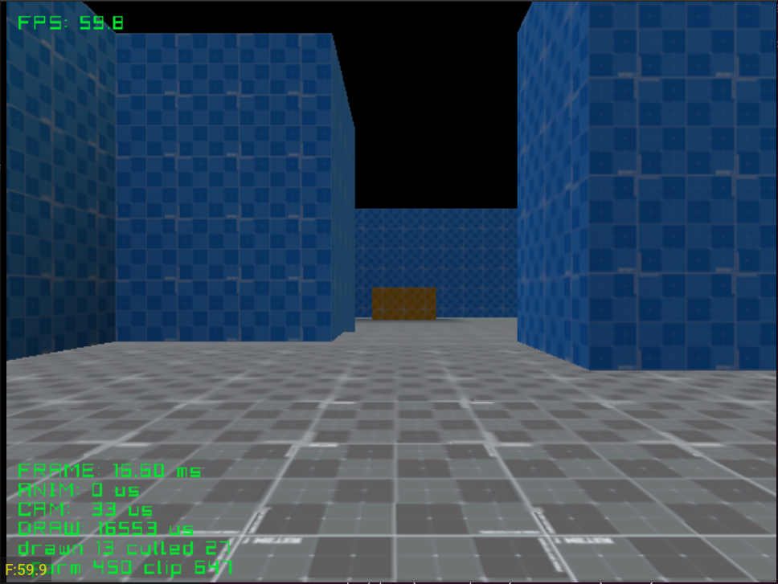

# 1st_person

First-person walk through a level with collision. Stresses the near-plane
clipper, since walls and floors are always crossing the camera.

See the [top-level README](../../README.md) for building.
