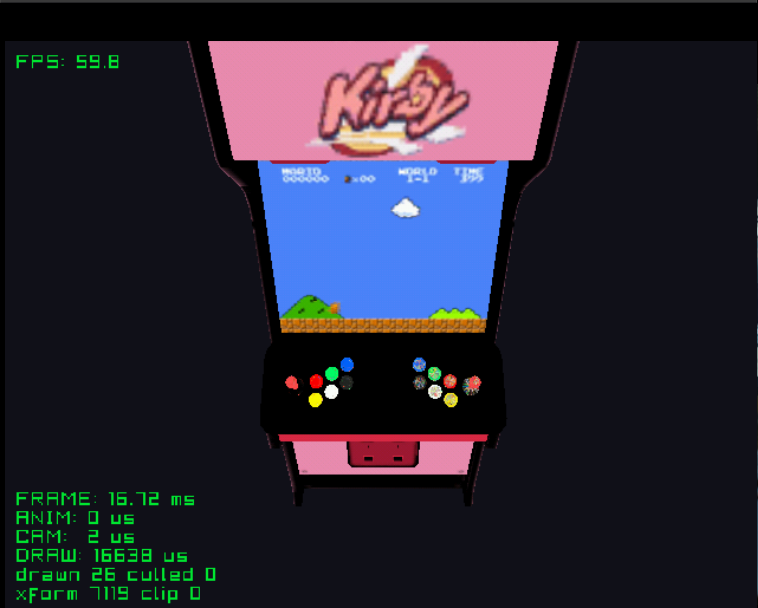

# arcade

An arcade cabinet with a game playing on its screen. The screen is a flipbook
of 64 frames shown 12 times a second, with the video's sound looping along.

See the [top-level README](../../README.md) for building.
