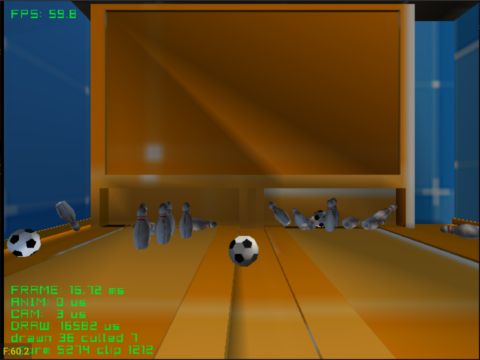

# bowling

Ten-pin bowling with picophysics. Two lanes of ten pins, and balls rolled from
the camera.

| Button | Action |
|---|---|
| A | Roll a ball |
| Y | Reset the pins |
| Start | Exit |

Credits: to add

See the [top-level README](../../README.md) for building.
