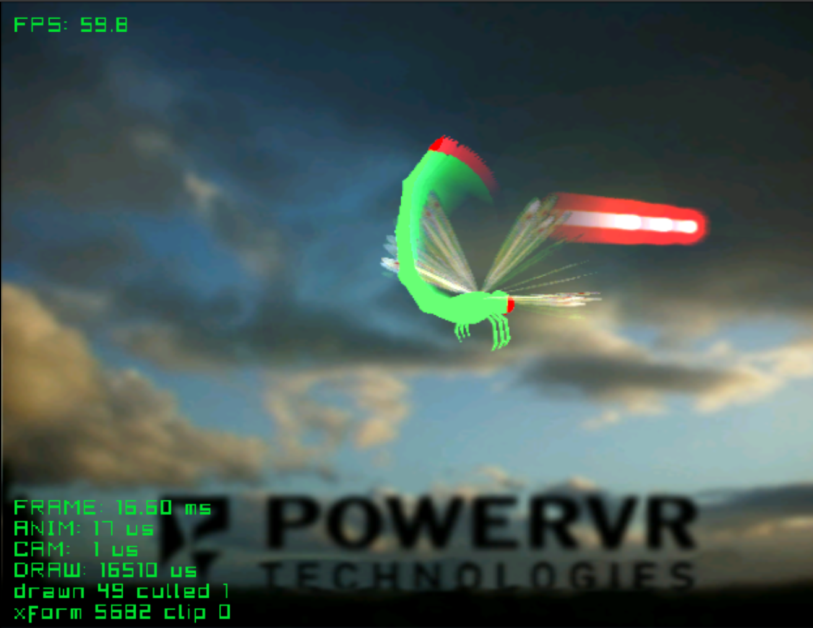

# dragonfly

The dragonfly from Sega's Katana SDK demo, with motion blur. Its 18 parts move
on their own (no skin). Every frame it is also drawn into a texture over a
faded copy of last frame's texture, and that is added over the screen, so
what moves leaves a trail. Shots are a flat glow drawn additive
(`dc_draw_ex` with `.add`); the trail draws them out into beams.

| Button | Action |
|---|---|
| Stick | Turn the camera around the dragonfly |
| L / R | Zoom |
| X | Fire |
| Start | Exit |

Credits:
- Model and textures: DragonFly demo, Sega Katana SDK (PowerVR / VideoLogic)

See the [top-level README](../../README.md) for building.
