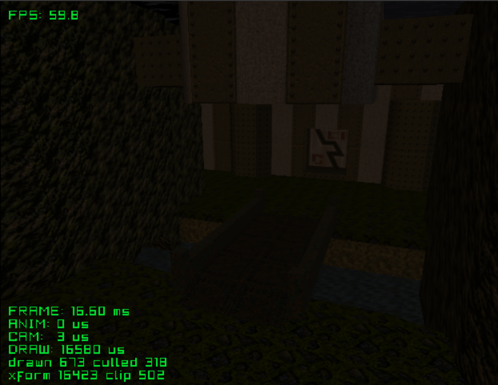

# e1m1

Free camera through Quake's first level, The Slipgate Complex. An indoor
level with baked vertex lighting.

Credits:
- Level: [Quake E1M1 - The slipgate complex](https://sketchfab.com/3d-models/quake-e1m1-the-slipgate-complex-73b496882bce49bb975300ab38295a0b)
  by [barney86](https://sketchfab.com/barney86)

See the [top-level README](../../README.md) for building.
