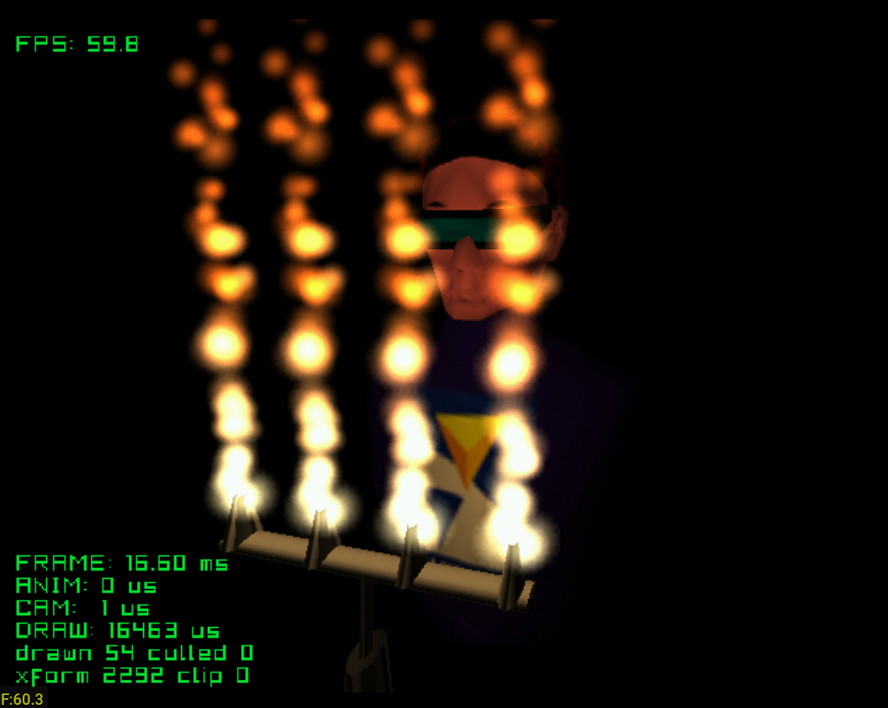

# fire

Four gas flames on a burner lighting a head and torso, after Fire from Sega's
Katana SDK. Turning the gas up makes the flames stand taller and the light on
the face brighter: one number does both, so they cannot drift apart. The flames
are not in the model and never were — the `.glb` holds eight points in a mesh
that is never drawn, four at the bottom of the flames and four at the top, and
`dc_model_points()` reads them out so the particles land where the artist put
them.

| Button | Action |
|---|---|
| D-pad up / down | Turn the gas up and down |
| Stick | Turn the camera |
| L / R | Zoom |
| X | Swap the light in the burner for the original's moving sun |
| B | Light off |
| Y | Flames off |
| Start | Exit |

Credits:
- Model and textures: Fire demo, Sega Katana SDK (`Kamui2/k2Gasfl`)

See the [top-level README](../../README.md) for building.
