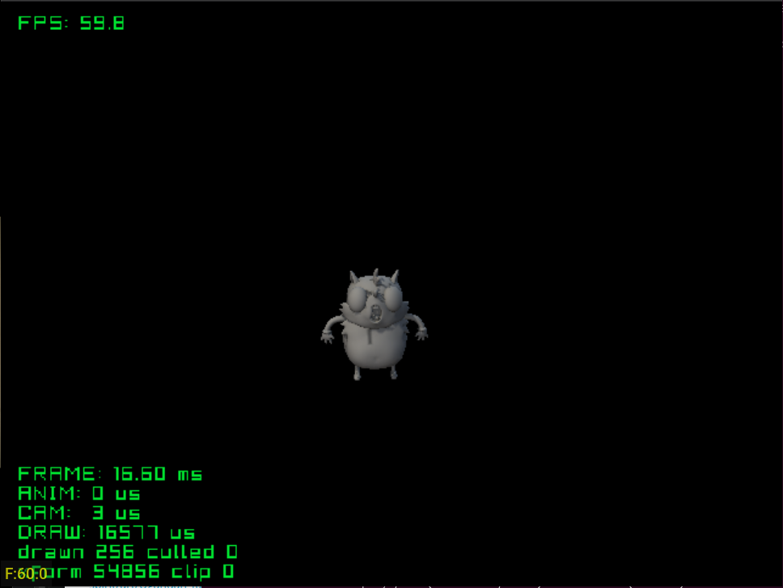

# highpoly

Free camera over a high-poly model (about 40,000 triangles on screen), to find
the polygon rate limit: about 2.3 million polygons a second. 

Credits:
- Model: [[Free] Ugandan Tails](https://sketchfab.com/3d-models/free-ugandan-tails-cd6dca09d7ed4838b6c0d71c5adc448c)
  by [LuAnton](https://sketchfab.com/LuAnton)

See the [top-level README](../../README.md) for building.
