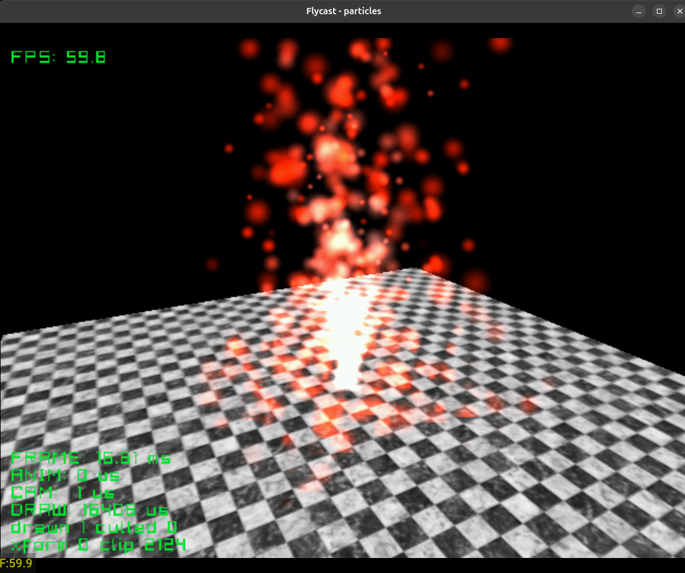

# particles

A fountain of fire over a marble floor: 600 particles thrown up from a spot,
pulled back down and bouncing when they land, grey-pink as they are born, red
at their height, out as they die. After Particles from the PowerVR SDK. The
whole thing is one `dc_particles_create` and one `dc_particles_draw` a frame.

Still a work in progress.. Needs speeding up. 

| Button | Action |
|---|---|
| Stick | Turn the camera around the fountain |
| L / R | Zoom |
| A | Throw a burst of 200 |
| Start | Exit |

Credits:

See the [top-level README](../../README.md) for building.
