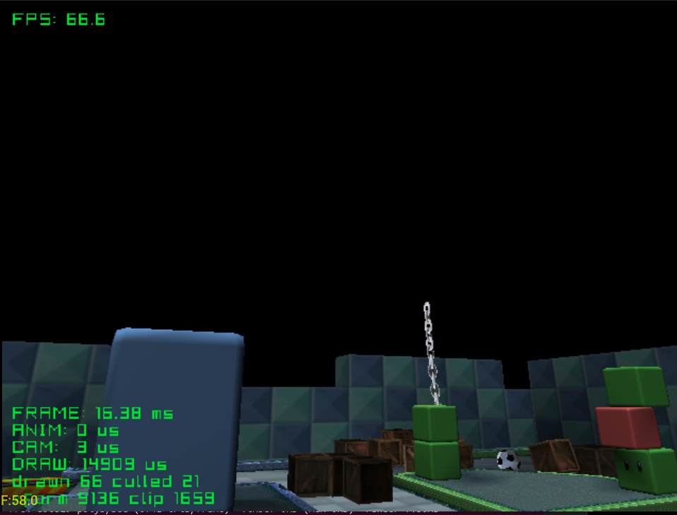

# picophysics

Rigid body physics.
(`dms/picophysics.h`). Bodies collide with the level through the engine's
collision grid. A crate and a ball drop at the start, and a wrecking ball
swings on a chain of 14 jointed links.

| Button | Action |
|---|---|
| A | Throw a ball |
| X | Throw a crate |
| Y | Reset |
| Start | Exit |

Credits:
- Level: [GameCube - Mario Kart Double Dash - Block City](https://sketchfab.com/3d-models/gamecube-mario-kart-double-dash-block-city-9d8002b53a884d0290759f05694a49c3)
  by [jkimmel694](https://sketchfab.com/jkimmel694)
- Ball, crate, chain: to add

See the [top-level README](../../README.md) for building.
