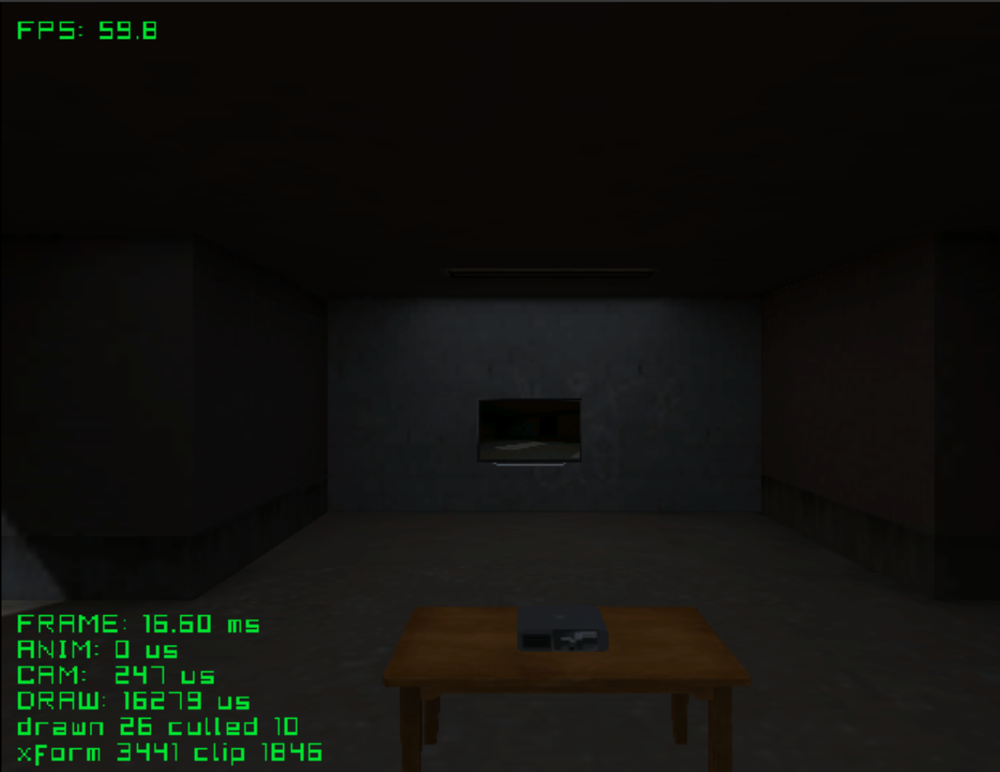

# projector

First-person walk through a room with a TV that shows the room live, from a
camera turning on the projector (render to texture). The TV's screen is a
plain rectangle with a material named `RTT_effect`; one call puts the picture
on it.

Credits:
- Room, TV, projector, table: to add

See the [top-level README](../../README.md) for building.
