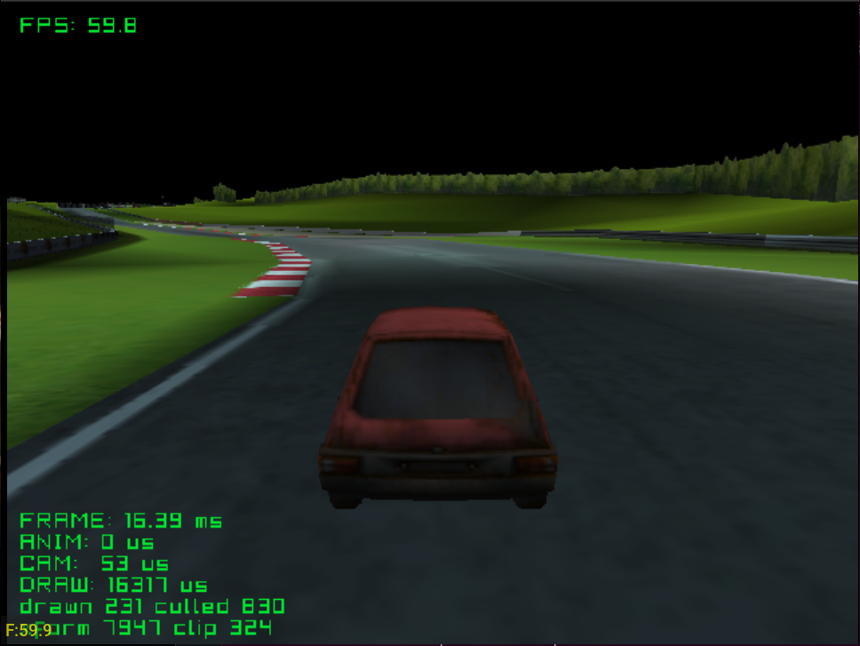

# race_track

A large racing track with a car, third-person camera and collision. The
track is close to a worst case for per-mesh overhead: many materials spread
over many small meshes.

Credits:
- Track: [nurburgring (race driver grid ds)](https://sketchfab.com/3d-models/nurburgring-race-driver-grid-ds-fc6393b88aa64fc98e63ee65846d3fc3)
  by [amogusstrikesback2](https://sketchfab.com/amogusstrikesback2)
- Car: to add

See the [top-level README](../../README.md) for building.
