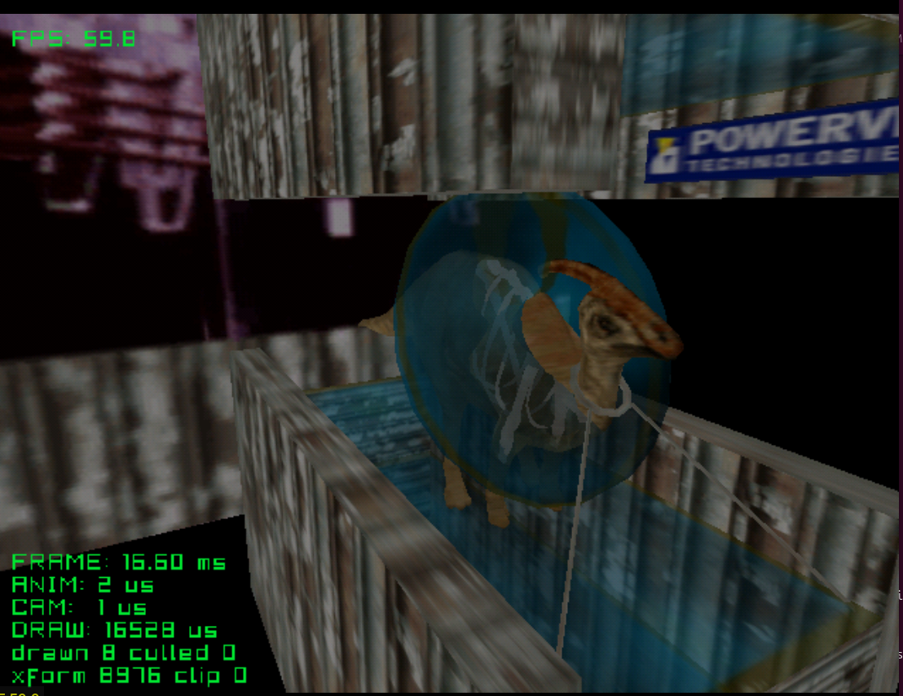

# scanner

A dinosaur under an x-ray scanner: where the scanner window crosses its skin,
the skin goes see-through and the skeleton underneath shows. After Scanner from
Sega's Katana SDK. The window is a modifier volume, and the whole set —
dinosaur, bones, scanner, stand and the animation — is one `.glb`.

| Button | Action |
|---|---|
| Stick | Turn the camera around the dinosaur |
| L / R | Zoom |
| A | Pause the animation |
| B | Hide the scanner ring |
| Y | Turn the window off |
| Start | Exit |

Credits:
- Model and textures: Scanner demo, Sega Katana SDK (PowerVR / VideoLogic)

See the [top-level README](../../README.md) for building.
