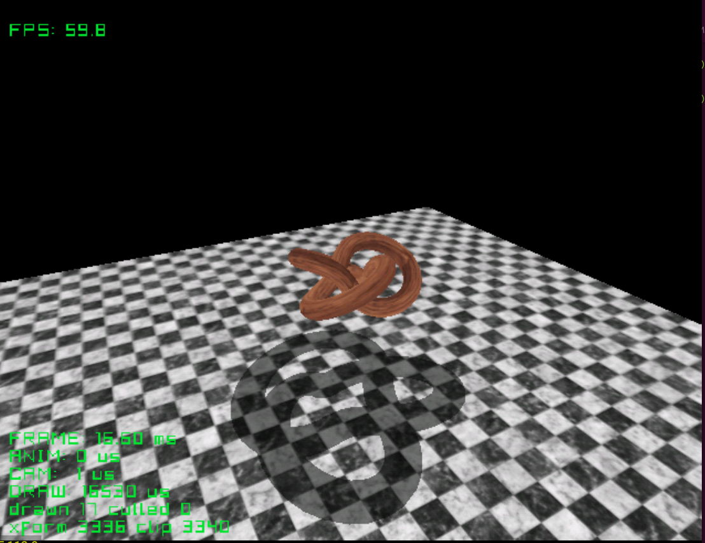

# shady

A wooden knot turning over a marble floor, with a flat shadow thrown away from
a light you can move. After Shady from Sega's Katana SDK. The shadow is one
field on the draw (`.shadow`), for any model, moving or not.

| Button | Action |
|---|---|
| Stick | Turn the camera around the knot |
| L / R | Zoom |
| D-pad | Move the light |
| Start | Exit |

Credits: to add

See the [top-level README](../../README.md) for building.
