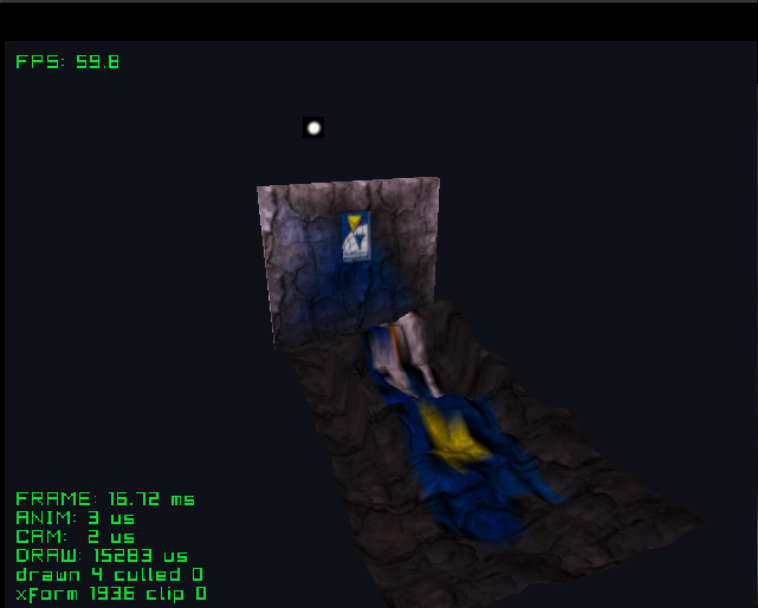

# stained

A lamp behind a wall shines through a stained glass window onto the floor,
after Katana's stained glass sample. Each frame every floor vertex takes the
glass's colour, shadow or light, depending on what lies between it and the lamp.

See the [top-level README](../../README.md) for building.
