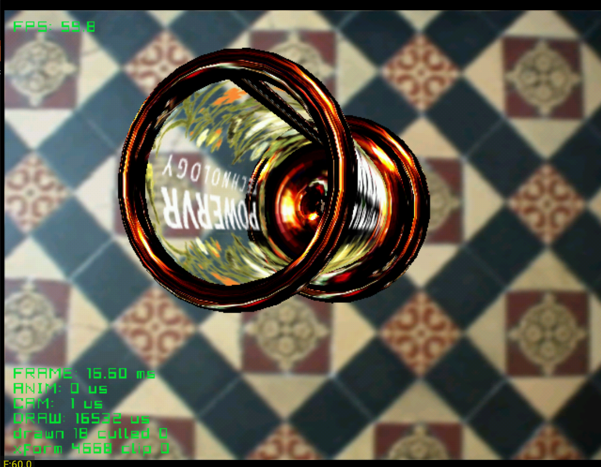

# vase

The first DMS demo, redone on the engine. After Vase from the PowerVR SDK: a
chrome and glass vase turning over a tiled floor, with the silver drawn as a
mirror and the glass carrying Katana's reflection passes. Reflections are asked
for with Metallic in Blender and switched on with one call,
`dc_set_environment()`.

| Button | Action |
|---|---|
| D-pad | Move the vase |
| A / B | Turn it left and right |
| X / Y | Tip it up and down |
| Start | Exit |

Credits:
- Model, background and reflection image: Vase demo, PowerVR SDK / Sega Katana SDK

See the [top-level README](../../README.md) for building.
